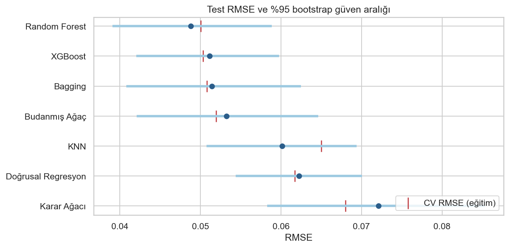
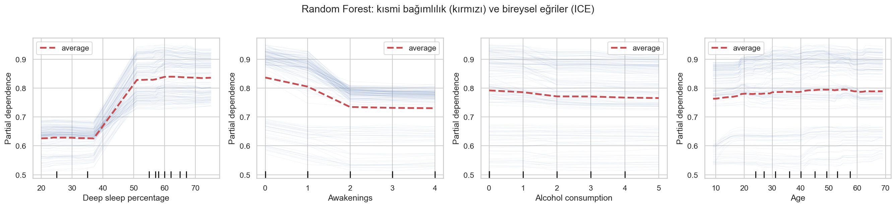
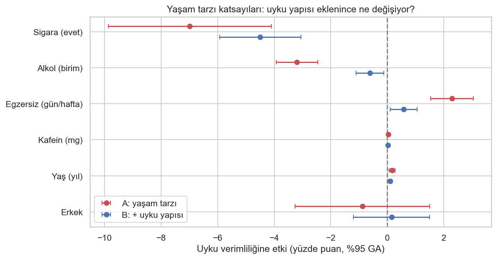

# 😴 Uyku Verimliliği: Tahmin ve Yaşam Tarzı Etkileri


452 kişinin bir gecelik uyku kaydını kullanarak iki soruya cevap aradım:

1. **Tahmin:** Uyku verimliliğini (yatakta geçen sürenin uyuyarak geçen oranı) ne kadar iyi tahmin edebiliriz, hangi model en iyisi?
2. **Açıklama:** Alkol, sigara, kafein ve egzersiz uyku verimliliğiyle nasıl ilişkili, bu ilişki uyku yapısı üzerinden mi geçiyor?

Bu iki soru farklı araçlar gerektiriyor. İlki için yedi modeli sızıntısız bir **nested cross-validation** düzeninde karşılaştırdım,
ikincisi için robust standart hatalı bir **OLS** modeli kurdum.

> 📓 **Tüm analiz, kod ve çıktılar:** [`uyku_verimliligi.ipynb`](uyku_verimliligi.ipynb)

---

## ✨ Öne Çıkanlar

- **Veri kalitesi kontrolleri:** REM + derin + hafif uyku yüzdelerinin her satırda tam 100 olduğunu (kompozisyon kısıtı, tam çoklu doğrusallık)
  ve `Wakeup time` tarihinin gece yarısından önce yatanlarda bir gün geri yazıldığını tespit ettim. Hafif uyku referans olarak modelden çıkarıldı,
  yatış saati ayrı bir değişken olarak türetildi.
- **Sızıntısız değerlendirme:** eksik değer doldurma ve ölçekleme pipeline içinde. Hiperparametreler iç CV'de, genelleme hatası dış CV'de
  (5 kat × 3 tekrar) ölçülüyor. Test seti en sonda bir kez kullanılıyor.
- **Farklar istatistiksel olarak sınandı:** CV katları bağımsız olmadığı için Nadeau-Bengio düzeltmeli t-testi, test setinde ise
  eşleştirilmiş bootstrap güven aralıkları kullanıldı.
- **Yorumlanabilirlik:** impurity tabanlı önem yerine test setinde permütasyon önemi, kısmi bağımlılık (PDP) ve ICE eğrileri.
- **Açıklayıcı model:** HC3 robust standart hata (Breusch-Pagan heteroskedastisiteyi doğruluyor), VIF kontrolü ve eksik veri için duyarlılık analizi.

---

## 📊 Sonuçlar: Tahmin

| Model | Nested CV RMSE | Test RMSE [%95 GA] | Test R² |
|---|---|---|---|
| **Random Forest** | **0.0500** | **0.049** [0.039, 0.059] | **0.872** |
| XGBoost | 0.0503 | 0.051 [0.042, 0.060] | 0.860 |
| Bagging | 0.0508 | 0.051 [0.041, 0.063] | 0.858 |
| Budanmış Ağaç | 0.0520 | 0.053 [0.042, 0.065] | 0.848 |
| Doğrusal Regresyon | 0.0617 | 0.062 [0.054, 0.070] | 0.792 |
| KNN | 0.0650 | 0.060 [0.051, 0.069] | 0.806 |
| Karar Ağacı | 0.0680 | 0.072 [0.058, 0.085] | 0.721 |

<p align="center"></p>

- Random Forest, XGBoost, Bagging ve budanmış ağaç **istatistiksel olarak başabaş** (düzeltilmiş t-testi, p > 0.4).
- Doğrusal regresyon belirgin şekilde geride (p < 0.001); test setinde RF ile arasındaki RMSE farkının %95 GA'sı [0.006, 0.021].
  Sebep, ilişkilerin eşik benzeri yapısı: derin uyku %40–50 aralığını geçince verimlilik sıçrıyor, iki ve üzeri uyanmada düşüp sabitleniyor.
- Tek bir karar ağacını budamak hatayı %24 azaltıyor.

<p align="center"></p>

## 🔍 Sonuçlar: Yaşam Tarzı

Derin uyku ve uyanma sayısı aynı gece ölçülüyor; alkol ya da egzersizin verimlilik üzerindeki etkisi bu değişkenler *üzerinden* gerçekleşiyor olabilir.
Bu yüzden iki model kurdum: yalnızca yaşam tarzı ve demografi (A) ve buna uyku yapısının eklendiği model (B).

<p align="center"></p>

| Değişken | Model A | Model B (+ uyku yapısı) |
|---|---|---|
| Sigara (evet) | −7.0 puan | −4.5 puan |
| Alkol (birim başına) | −3.2 puan | −0.6 puan |
| Egzersiz (haftada +1 gün) | +2.3 puan | +0.6 puan |

- Alkol ve egzersizin verimlilikle ilişkisinin **büyük kısmı derin uyku ve uyanma üzerinden geçiyor**. Sigaranın ise uyku yapısıyla açıklanamayan
  bir ilişkisi de var.
- Yaşam tarzı ve demografi tek başına verimliliğin yalnızca ~%24'ünü açıklıyor (CV R²); tahmin için uyku yapısı ölçümleri şart.
- Veri kesitsel ve gözlemsel; bu katsayılar nedensel etki değil, koşullu ilişki olarak yorumlanmalı.

---

## 🛠️ Yöntem

```
Ham veri (452)
  └─ Kalite kontrolü: kompozisyon kısıtı, tarih hatası, eksiklik analizi (Mann-Whitney)
       └─ %80 / %20 ayrım
            ├─ Eğitim (361)
            │    ├─ Nested CV — dış: 5 kat × 3 tekrar, iç: 5 katlı GridSearchCV (RMSE)
            │    │    Pipeline: medyan doldurma → [ölçekleme] → model
            │    └─ Nadeau-Bengio düzeltmeli t-testi ile model karşılaştırması
            └─ Test (91) — yalnızca bir kez: RMSE, MAE, R², bootstrap GA, permütasyon önemi, PDP
Açıklayıcı analiz: OLS (HC3), Model A vs Model B, VIF, Breusch-Pagan, eksik veri duyarlılık analizi
```

## 🚀 Çalıştırma

```bash
git clone https://github.com/suleymanrubaroral/uyku-verimliligi-regresyon.git
cd uyku-verimliligi-regresyon
pip install -r requirements.txt
jupyter notebook uyku_verimliligi.ipynb
```

## 📁 Klasör Yapısı

```
├── uyku_verimliligi.ipynb   # tüm analiz (çıktılarıyla)
├── data/Sleep_Efficiency.csv
├── figures/                 # notebook'un ürettiği grafikler
├── requirements.txt
└── README.md
```

## 🔭 Geliştirme Fikirleri

- Hedef 0–1 aralığında sınırlı ve sola çarpık: beta regresyonu ile açıklayıcı modelin yeniden kurulması
- Aracılık ilişkisinin resmi bir aracılık analiziyle (bootstrap dolaylı etki) sınanması
- Bireylerin birden fazla gecesini içeren bir veriyle karma etkili model

---

<details>
<summary><b>🇬🇧 English summary</b></summary>

Sleep efficiency (share of time in bed actually spent asleep) for 452 participants. Two questions are answered with two different toolsets.
**Prediction:** seven regressors (linear regression, KNN, decision tree, cost-complexity-pruned tree, bagging, random forest, XGBoost) are compared
with nested cross-validation (5×3 outer, 5-fold inner), all preprocessing inside pipelines, Nadeau-Bengio corrected t-tests and a single
hold-out evaluation with bootstrap CIs. Tree ensembles and the pruned tree are statistically tied (test RMSE ≈ 0.049–0.053, R² ≈ 0.85–0.87) and clearly
beat linear regression because the effects of deep-sleep share and awakenings are threshold-like. **Explanation:** OLS with HC3 robust errors shows that
alcohol (−3.2 pp per unit), smoking (−7.0 pp) and exercise (+2.3 pp per weekly day) are associated with efficiency, and that most of the alcohol and
exercise association disappears once sleep architecture is controlled for — consistent with an effect that runs through deep sleep and awakenings.
Data-quality checks uncovered a compositional constraint (REM + deep + light = 100) and a date error in wake-up times.

</details>
